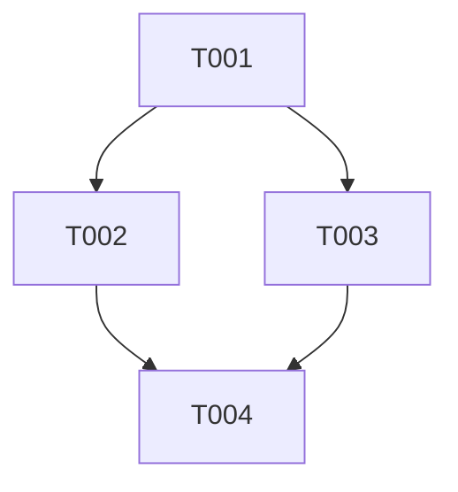

# DAG Document Format

创建或修订 DAG.md、CONTEXT.md 和目录结构时读取本文件。这里定义文档格式，Planner 生命周期和停止边界见 [SKILL.md](../SKILL.md)。任务 schema 见 [task-contract.md](task-contract.md)；需要编码执行模式和交接细节时再读 [execution-protocol.md](execution-protocol.md)。

本文的 Executor、Coordinator、worktree、integration 和 status lifecycle 描述属于 generated DAG execution contract，供未来会话使用，不是 current dag-planner runtime instructions。业务路径和实现步骤只能写入未来 Task 契约；当前最终计划必须遵循 [Final Plan Contract](../SKILL.md#final-plan-contract)，不能将这些示例当成 Planner 的实施清单。

# Directory Layout

```text
.dag/
└── YYYYMMDD-feature-or-goal-slug/
    ├── DAG.md
    ├── CONTEXT.md
    └── tasks/
        ├── T001-short-slug.md
        ├── T002-short-slug.md
        └── T003-short-slug.md
```

目录名即 `dag_id`。日期取创建时的项目本地日期；slug 使用简短、有业务含义的英文小写和连字符。创建前检查重名，独立需求重名时追加 `-02`、`-03`。拒绝 `plan`、`task1`、`new-feature`、`temp`、`dag1` 等无明确含义的名称。

目录创建后保持稳定。Task ID 规则见 [task-contract.md](task-contract.md#task-identity-and-status)。

内部 Markdown 链接相对于当前文件：DAG 指向 `tasks/T002-xxx.md`，Task 指向 `../CONTEXT.md` 或同目录依赖 Task。代码路径和 scope 统一相对于 repository root，使用 `/`，并明确这一基准。禁止写入机器绝对路径作为交接依据。

# DAG Model

`tasks/*.md` 的 front matter 是任务 ID、状态、依赖、执行模式和 scope 的唯一结构化来源（schema 见 [task-contract.md](task-contract.md#task-schema)）。DAG 索引、Mermaid、Text Graph 和并行计划从同一组任务信息派生，修订时同时同步。

每条边 `A -> B` 表示 B 需要 A 的指定输出及验收证据，不是“可能相关”。所有活跃节点应服务于 Goal 或 Definition of Done；独立交付物可以无依赖，但必须说明其价值，不能为了连图添加虚假依赖。

`DAG.md` 使用以下模板。模板中的说明必须替换为本次已调查内容；空项明确写“无”及适用原因。

````markdown
---
dag_id: YYYYMMDD-goal-slug
title: 具体业务目标
status: DRAFT
created_at: "YYYY-MM-DDTHH:mm:ss+08:00"
revision: 1
related_dags: []
---

# Goal
明确问题、目标用户及预期结果。

# Confirmed Requirements
使用 R1、R2 等稳定需求编号，描述确认后的行为。

# Assumptions
列出假设及不成立时的影响。

# Unknowns
列出未解决问题、受阻任务和解除条件。

# Out of Scope
界定非目标。

# Architecture Summary
描述受影响模块、数据流、接口、所有权和兼容策略，链接 CONTEXT。

# DAG

## Mermaid


## Text Graph
```text
T001: depends_on = []
T002: depends_on = [T001]
T003: depends_on = [T001]
T004: depends_on = [T002, T003]
```

# Tasks
| ID | Task | Type | Status | Depends On | Parallel Group | Execution | Agent |
|---|---|---|---|---|---|---|---|
以实际任务生成每一行，Task 名称链接到 tasks/Txxx-slug.md。

# Parallel Execution Plan
逐组列出 Task、启动条件、能否同时执行、推荐 Session 数和执行模式。

# Critical Path
列出决定完成顺序的依赖链，说明计算依据及并列路径。

# Write Scope Analysis
列出逐任务写入范围矩阵、重叠路径、共享副作用、处理方式和集成所有者。

# Integration Strategy
指定基础版本、产物获取方式、集成顺序、冲突边界及统一验证。

# Risks
列出风险、触发条件及负责处理的 Task。

# Definition of Done
将每项需求映射到 Task、可观察结果及验证证据；最终验证区分 Automated Verification 与 Manual Verification，并记录 Verification Result。

# Change Log
## Revision 1
记录初始任务、依赖、范围及并行策略。
````

创建时间使用实际时区，不照抄模板示例的偏移量。图中必须包含无边的活跃任务；SUPERSEDED 任务保留在索引中，标明其替代者，不参与当前执行图。

# DAG Status

DAG front matter 的 status 允许 DRAFT、CONFIRMED、IN_PROGRESS、BLOCKED、DONE、SUPERSEDED。Planner 创建时采用 DRAFT 或 CONFIRMED；执行阶段流转与 Coordinator 同步见 [execution-protocol.md](execution-protocol.md#status-lifecycle)。

# Context Management

CONTEXT 保存共享扩展信息；Task 自身必须保留最小可执行背景、Goal、Scope 和 Acceptance Criteria，不能只写“见 CONTEXT”或“按之前讨论实现”。使用以下结构：

```markdown
# Project Context
项目类型、平台、实际工具链和调查基线。
# Relevant Architecture
模块职责及边界。
# Existing Flow
生命周期、数据流和失败路径。
# Important Files
真实路径、符号和作用。
# Existing APIs
现有及本次明确变更的接口契约。
# Data Structures
配置、运行时数据、存档和兼容规则。
# Constraints
确认的范围、性能、平台和变更限制。
# Repository Findings
调查证据、差异、未验证项和已有用户改动。
# Coding Conventions
适用指令的路径和本任务关键约定。
# Build / Test Context
真实命令、工作目录、环境前提和人工验收入口。
```

默认不读取其他 DAG 的上下文。只有 DAG.md 的 `related_dags` 明确列出的目录才可按需引用，并写清依赖产物及定位链接；该列表不会建立跨 DAG 的 `depends_on`。关键结论仍应写入当前目录，使归档后的执行不依赖历史聊天。

# Parallel and Write Scope Format

使用拓扑批次 `P1`、`P2` 等推荐同批可启动节点，再根据写入与语义冲突拆分批次。每组声明任务、启动条件、是否能同时执行、建议 Copilot Session 数和执行模式。

可并行要求：依赖输出已验收且可获取、接口已确定、无架构先后要求、写入与共享副作用已隔离。Task 进入某个组不等于已经 READY；仍须由协调者检查实际输入。

推荐最大并行数取可安全并发批次的任务数，并考虑用户资源上限；未获知资源时标记为结构上限，不虚构调度器容量。

写入冲突矩阵使用以下列；实际分析原则见 [SKILL.md](../SKILL.md#parallel--write-scope-conflict-analysis)。

| Task | Write Scope | Overlap With | Shared Side Effects | Resolution | Integration Owner |
|---|---|---|---|---|---|
| Txxx | 具体文件或 glob | 重叠任务或无 | 生成器、构建、端口等 | 合并、依赖、隔离与集成 | 明确任务或外部机制 |

Parallel Execution Plan、Critical Path、Integration Strategy、Risks、Definition of Done 沿用 DAG 模板的章节与含义。Critical Path 无工时依据时写结构最长依赖链及并列路径，不将结构深度声称为工期。Integration Strategy 必须写明共同基线、产物获取/应用顺序、允许冲突边界和统一验证；具体执行规则按需加载 [execution-protocol.md](execution-protocol.md#integration-strategy)。最终验证节点与 Definition of Done 必须区分 Automated Verification 与 Manual Verification：结果不是 `PASS` 时保留 `PARTIAL` / `MANUAL_VERIFICATION_REQUIRED` token 与未决人工清单，不宣称游戏交互、视觉效果或手感已验证；验证优先级见 [SKILL.md](../SKILL.md#verification-strategy) 与 [task-contract.md](task-contract.md#validation-task-contract)。

# Change Log Rules

每次影响执行的修订递增 DAG `revision`，记录原因、Added、Changed、Superseded 和 Parallel Group Changes，指出受影响 Task 与需要重新确认的产物。

记录任务、依赖、范围、架构、验收、执行模式和并行度变化，不为纯文字润色或重复状态同步增加执行修订。执行交接中的 revision 核对见 [execution-protocol.md](execution-protocol.md#status-lifecycle)。

# Examples

以下路径和功能是假设项目示例，用于说明拆分方式，不能作为实际仓库事实复制。

需求：为一个客户端和服务端增加约定一致的缓存能力。

```text
.dag/20260907-client-server-cache/
├── DAG.md
├── CONTEXT.md
└── tasks/
    ├── T001-design-cache-contract.md
    ├── T002-implement-client-cache.md
    ├── T003-implement-server-cache.md
    └── T004-integrate-cache.md
```

| Task | Depends On | Input / Output | Write Scope | Group / Mode |
|---|---|---|---|---|
| T001 | 无 | 已确认需求 → `api_contract`（`research/T001-design-cache-contract.md`） | 自身任务文档及结论文件 | P1 / readonly |
| T002 | T001 | `T001.api_contract` → `client_cache` | `src/client/cache.ts`, `tests/client/cache.test.ts` | P2 / isolated_worktree |
| T003 | T001 | `T001.api_contract` → `server_cache` | `src/server/cache.ts`, `tests/server/cache.test.ts` | P2 / isolated_worktree |
| T004 | T002,T003 | 两个实现产物 → `integrated_cache`, `verification_report` | 上述四个文件及 `tests/cache.integration.ts` | P3 / integration |

表中各 Task 的实际 `write_scope` 还须包含自身任务文档，仅供状态和报告维护。T001 执行时创建研究结论文件；T002、T003 的 `inputs` 与 `read_scope` 均指向该文件。执行状态更新和索引同步按 [execution-protocol.md](execution-protocol.md#status-lifecycle) 编码到生成契约。


```text
T001: []
T002: [T001]
T003: [T001]
T004: [T002, T003]
```

T001 产物未持久化、下游规格未据此确定前，T002/T003 不能 READY。P2 推荐两个独立 worktree，会合到 T004；结构关键路径有两条：T001 → T002 → T004 与 T001 → T003 → T004，不能据此声称两条耗时相同。

若 T002 和 T003 都需修改 `src/contracts/api.ts`，不能继续声明无冲突。优先将该文件的实现交给独立的串行契约节点，或合并耦合任务；只有修改可以独立完成且集成责任明确时，才保留带 expected merge conflict 的隔离并行。

如果后续修改服务端失效规则，更新同一目录，保留 T003 ID；若 T003 已完成但新标准需要额外实现，新增 T005 并修订集成依赖、受影响后继及 revision，不把历史 T003 的验证结果当作新需求证据。
